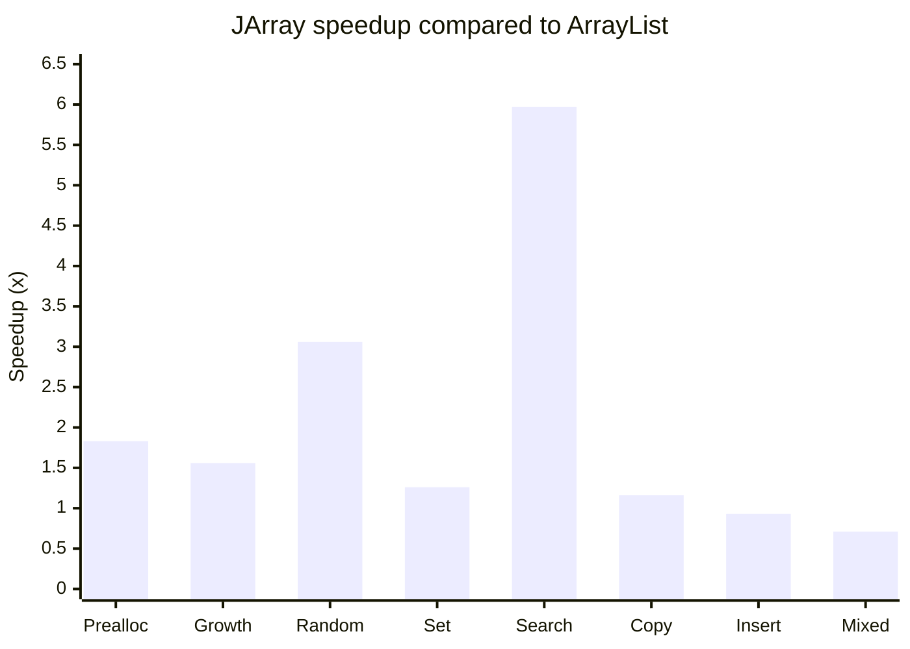

# JArray

**More than an array. More than a list.**

JArray is a flexible Java data structure that brings together dynamic arrays, primitive storage, mixed data types, and multidimensional array operations.

Built to make working with data more flexible without sacrificing performance.

## Why JArray?

Java gives developers two common choices when working with collections:

- **Arrays** are fast and memory-efficient, but have a fixed size and limited flexibility.
- **ArrayList** provides dynamic sizing and convenient manipulation, but stores elements as object references. Primitive values must be boxed.

JArray was created to bridge that gap.

It combines the convenience of a dynamically resizable collection with specialized storage for primitive types. It also goes beyond traditional lists by supporting multidimensional arrays, slicing, reshaping, and views.

The goal isn't to replace every Java collection. It's to provide another tool for developers who need more control over how their data is stored and accessed.

### What makes it different?

- **Primitive-first storage:** Store integers, floats, doubles, and other primitive types directly without requiring wrapper objects for every element.
- **Dynamic sizing:** Add, insert, and remove elements without manually managing array capacity.
- **Mixed-type support:** Store different data types in the same JArray.
- **Multidimensional arrays:** Organize data across multiple dimensions.
- **Views:** Access existing data through alternative shapes and layouts without necessarily copying it.
- **Flexible manipulation:** Slice, reshape, transpose, flatten, search, copy, reverse, and more.

## Features

| Feature | Description |
|---|---|
| Dynamic arrays | Automatically resize as elements are added |
| Primitive storage | Specialized backing arrays for primitive types |
| Mixed types | Combine different data types |
| Multidimensional arrays | Support multiple dimensions |
| Views | Access existing storage without unnecessary copies |
| Slicing | Extract portions of an array |
| Reshaping | Change array dimensions |
| Transposing | Rearrange multidimensional layouts |
| Searching | Find elements and count occurrences |
| Manipulation | Insert, remove, swap, reverse, and fill |
| Iteration | Work with elements using Java iteration |

## Performance

JArray was designed with performance and memory efficiency in mind.

Its storage system uses two approaches:

- **Uniform storage:** When all elements share the same type, values are stored directly in a specialized backing array without per-element metadata.
- **Mixed storage:** When different types are present, JArray uses compact metadata to track the type and physical location of each element.

This allows JArray to avoid unnecessary overhead when working with homogeneous primitive data while retaining support for heterogeneous arrays.

### JArray vs. ArrayList

The following results come from JArray's benchmark suite, comparing it against Java's standard `ArrayList`.

**Test size: 1,000,000 elements**

The chart shows relative performance. A value above 1.0 means JArray was faster; below 1.0 means ArrayList was faster.



**Actual benchmark timings**

| Operation | JArray | ArrayList | Result |
|---|---:|---:|---:|
| Preallocated append | 2.501 ms | 4.573 ms | JArray 1.83× faster |
| Automatic-growth append | 4.703 ms | 7.336 ms | JArray 1.56× faster |
| Random access | 0.482 ms | 1.475 ms | JArray 3.06× faster |
| Sequential iteration | 0.243 ms | 1.389 ms | JArray 5.72× faster* |
| Set existing elements | 2.223 ms | 2.812 ms | JArray 1.26× faster |
| Unsuccessful search | 1.427 ms | 8.515 ms | JArray 5.97× faster |
| Middle insertion + removal | 1.801 ms | 1.666 ms | ArrayList 1.08× faster |
| Copy | 6.915 ms | 8.035 ms | JArray 1.16× faster |
| Mixed-type insertion | 8.730 ms | 6.238 ms | ArrayList 1.40× faster |

*The iteration result is included as reported by the benchmark, but its normalized per-element timing needs further validation.*

JArray isn't faster at everything. ArrayList currently has an advantage in mixed-type insertion and middle insertion/removal in this test.

The important takeaway is that JArray can offer substantial advantages for certain workloads, especially when working with homogeneous primitive data.

### Memory usage

Approximate heap measurements from the same benchmark suite:

| Elements | JArray | ArrayList |
|---:|---:|---:|
| 100,000 | 417 KB | 1,979 KB |
| 200,000 | 938 KB | 4,119 KB |
| 1,000,000 | 6,144 KB | 21,857 KB |

At one million elements, JArray used approximately **72% less memory** in this test.

These measurements are approximate heap deltas, not exact object-size measurements. Results can vary with JVM implementation, workload, and runtime conditions.

### Benchmark notes

- Results were collected using a custom benchmark harness with warmup rounds and repeated measurements.
- Reported timings use median measurements.
- Setup is excluded from operation timing.
- Memory measurements are approximate.
- Results are workload- and machine-dependent, not universal performance guarantees.

## Getting Started

### Requirements

- Java Development Kit (JDK 17 or newer)

### Building from Source

Clone the repository:

```bash
git clone https://github.com/AJ-1-code/JArray.git
cd JArray
```

Build the project:

**Windows**
```powershell
.\gradlew.bat build
```

**Linux / macOS**
```bash
./gradlew build
```

## Installation

JArray is available through JitPack, with Maven Central publication planned.

### JitPack

Add JitPack to your repositories:

**Gradle (Groovy)**

```groovy
repositories {
    mavenCentral()
    maven { url 'https://jitpack.io' }
}

dependencies {
    implementation 'com.github.AJ-1-code:JArray:1.0.0'
}
```

**Gradle (Kotlin DSL)**

```kotlin
repositories {
    mavenCentral()
    maven("https://jitpack.io")
}

dependencies {
    implementation("com.github.AJ-1-code:JArray:1.0.0")
}
```

Maven Central publication is planned.

Once the first artifact is published, JArray will be available through the standard Maven Central repository.

The official group ID and dependency coordinates will be listed here when publication is complete.

## Basic Usage

```java
import jarray.JArray;

public class Example {
    public static void main(String[] args) {

        // Create a dynamic array
        JArray numbers = new JArray();

        // Add elements
        numbers.add(10);
        numbers.add(20);
        numbers.add(30);

        // Retrieve an element
        System.out.println(numbers.get(1));

        // Change an element
        numbers.set(99, 1);

        // Insert an element
        numbers.insert(1, 15);

        // Remove an element
        numbers.removeAt(0);

        System.out.println(numbers);
    }
}
```

## Project Status

JArray is preparing for its first public release.

Bug reports, suggestions, and contributions are welcome. If you find an issue or have an idea for improving the library, feel free to open an issue or submit a pull request.

## License

JArray is released under the MIT License. See [LICENSE](LICENSE) for details.

---

**JArray — Flexible data structures, built for Java.**
